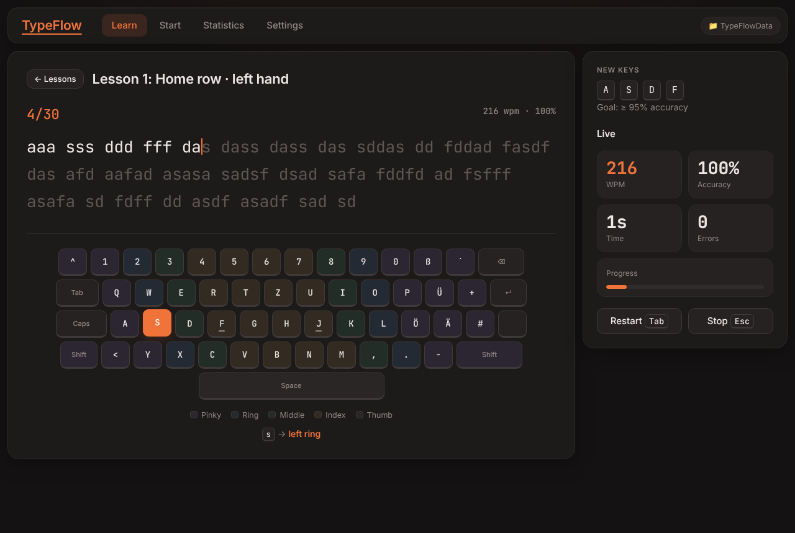
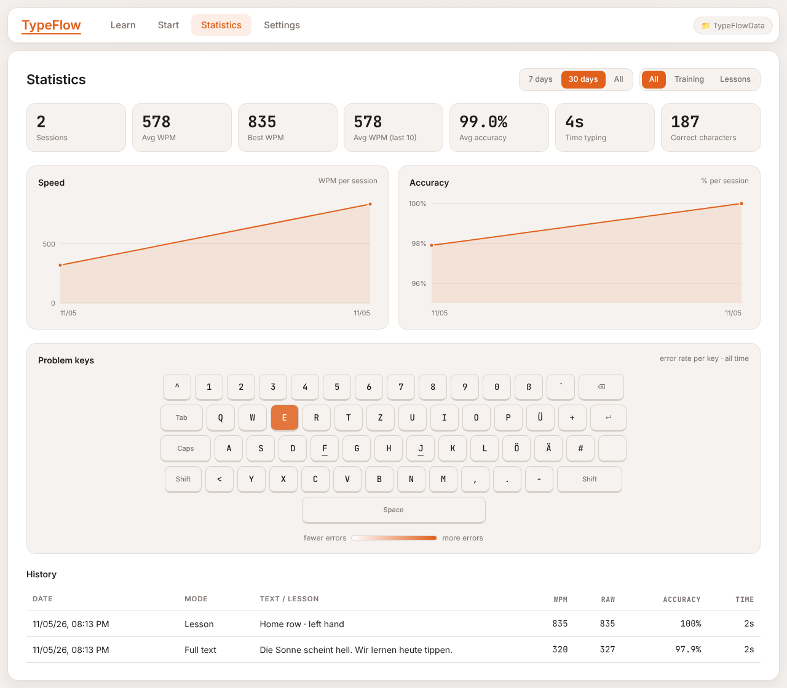

> [!NOTE]
> **Vibe-coded Projekt** – Dieses Projekt wurde größtenteils mit KI-Unterstützung entwickelt. Der Code funktioniert für meinen Anwendungsfall, ist aber nicht professionell geprüft. Nutzung auf eigene Verantwortung.

# TypeFlow

Ein Tipptrainer im Browser: beliebigen Text einfügen (z. B. eine Wikipedia-Seite) und so schnell wie möglich abtippen, 10-Finger-Schreiben in Lektionen lernen und den eigenen Fortschritt in Statistiken verfolgen.


-lightgrey)


---

## Preview

<p align="center">
  
  &nbsp;
  
</p>

---

## Inhaltsverzeichnis

- [Features](#features)
- [Voraussetzungen](#voraussetzungen)
- [Installation](#installation)
- [Nutzung](#nutzung)
- [Wichtige Hinweise](#wichtige-hinweise)
- [Konfiguration](#konfiguration)
- [Bekannte Probleme](#bekannte-probleme)
- [Roadmap](#roadmap)
- [Lizenz](#lizenz)
- [Credits](#credits)

---

## Features

- **Training (`Start`-Tab)**: eigenen Text einfügen, vier Modes:
  - `Full text`: der ganze Text von Anfang bis Ende
  - `Random`: 10, 25, 50 oder 100 zufällige Wörter aus dem Text
  - `Single`: immer nur ein großes Wort, mit Vorschau auf das nächste
  - `Time`: so viel wie möglich in 15, 30, 60 oder 120 Sekunden
- **Text-Cleanup**: Anführungszeichen und Bindestriche vereinheitlichen, Quellenverweise wie `[1]` entfernen, Satzzeichen entfernen, Kleinschreibung. Benutzte Texte werden gespeichert und sind als Chips wieder auswählbar.
- **Live-Stats** beim Tippen (WPM, Accuracy, Zeit, Fehler, Fortschritt) und ein Ergebnis mit Raw WPM, Speed-Chart pro Sekunde und den am häufigsten verfehlten Tasten.
- **Learn-Tab**: 16 aufbauende 10-Finger-Lektionen, von der Grundreihe über Umlaute, Satzzeichen, Großbuchstaben und Zahlen bis zu echten Wörtern. Eine Bildschirm-Tastatur ist nach Fingern eingefärbt, markiert die nächste Taste und zeigt den zuständigen Finger, inklusive `Shift`.
- **Statistics-Tab**: Kennzahlen, Verlauf von WPM und Accuracy, Heatmap der Problem-Tasten und Session-History. Filterbar nach Zeitraum (7 Tage, 30 Tage, alles) und Art (Training oder Lektionen).
- **Settings-Tab**:
  - Darstellung: Theme (`Dark`, `Light`, `System`), Schriftgröße, Caret-Stil
  - Tippen: Tastatur-Layout `QWERTZ (DE)` oder `QWERTY (US)`, Strict mode, Fehler-Ton, Bildschirm-Tastatur auch im Training
  - Lektionen: Accuracy-Ziel und Länge
  - Daten: JSON-Export, -Import und Reset
- **Speicherung im eigenen Ordner**: Alle Daten liegen in einer `typeflow-db.json` in einem selbst gewählten Ordner. Ohne Ordner wird der Browser-Speicher (`localStorage`) genutzt.
- **Eine einzige HTML-Datei**: `dist/typeflow.html` enthält die komplette App und läuft per Doppelklick, ohne Server und ohne Installation.

---

## Voraussetzungen

- **Chrome oder Edge**: für die Speicherung im Ordner (File System Access API)
- **Firefox oder Safari**: die App läuft auch dort, speichert dann aber nur im Browser
- **Nur zum Bauen und Testen**: Node.js 18+ (Unit-Tests mit dem eingebauten `node:test`) und Playwright für die E2E-Tests

---

## Installation

### Option A – Einzelne HTML-Datei herunterladen (empfohlen)

1. [`dist/typeflow.html`](dist/typeflow.html) öffnen und auf „Download raw file“ klicken
2. Die Datei in einen eigenen Ordner legen, z. B. `MeinTypeFlow/`
3. Die Datei per Doppelklick in Chrome oder Edge öffnen

Ein GitHub-Release gibt es noch nicht: [RELEASE-LINK]

### Option B – Aus dem Quellcode

```bash
git clone https://github.com/xypep/TypeFlow.git
cd TypeFlow
```

Lokal starten. Die Ordner-Funktion braucht einen „secure context“, also `localhost` oder `file://`:

```bash
python -m http.server 8000
```

Dann `http://localhost:8000` öffnen. Alternativ startet `npm start` den `http-server` über `npx` auf Port 8000.

Die Single-File-Version neu bauen. Das kopiert `css/styles.css` und alle Skripte aus `js/` in `dist/typeflow.html`:

```bash
npm run build
```

Tests:

```bash
npm test
```

```bash
npm install
npx playwright install chromium
npm run test:e2e
npm run test:e2e:single
```

`npm test` startet die Unit-Tests. `npm run test:e2e` testet den Quellcode über `http`, `npm run test:e2e:single` die Datei `dist/typeflow.html` über `file://`. Mit `SCREENSHOTS=1` werden Screenshots nach `tests/e2e/screenshots/` geschrieben.

---

## Nutzung

1. Beim ersten Start **`Choose folder`** klicken und einen Ordner wählen. Dort wird `typeflow-db.json` angelegt oder geladen. Alternativ **`Continue without folder (browser storage)`**.
2. Beim nächsten Start reicht **`Continue with „<Ordner>“`**. Der Browser fragt dabei nach der Berechtigung für den Ordner.
3. Im Tab **`Start`** einen Text einfügen (oder `✨ Sample text` wählen), rechts Mode und Optionen einstellen und **`Start`** drücken. Danach direkt lostippen, ohne vorher etwas anzuklicken.
4. Im Tab **`Learn`** eine Lektion wählen. Bestanden ist sie, wenn das Accuracy-Ziel erreicht wird (Standard: 95 %).
5. Im Tab **`Statistics`** den Verlauf ansehen. Den Speicherort wechselt man über den Chip oben rechts oder unter `Settings` → `Data`.

| Hotkey | Funktion |
|--------|----------|
| `Tab` | Session neu starten (auch auf dem Ergebnis-Screen) |
| `Esc` | Session abbrechen |
| `Backspace` | letztes Zeichen löschen |
| `Ctrl` / `Alt` + `Backspace` | letztes Wort löschen |

---

## Wichtige Hinweise

> [!WARNING]
> `Import JSON` ersetzt **alle** aktuellen Daten durch die importierte Datei, und `Reset…` löscht Sessions, Lektions-Fortschritt und Key-Stats. Beides fragt vorher nach, lässt sich aber nicht rückgängig machen. Vorher am besten mit `Export JSON` ein Backup machen.

> [!CAUTION]
> Im Modus „ohne Ordner“ liegen die Daten nur im `localStorage` des Browsers. Wer die Website-Daten oder den Browser-Cache löscht, verliert sie. Für dauerhafte Speicherung einen Ordner wählen.

> [!IMPORTANT]
> Die Speicherung im Ordner funktioniert nur in Chrome und Edge. Läuft die Seite eingebettet (z. B. in einem iframe), blockiert der Browser die Ordnerauswahl. Dann die Datei direkt öffnen.
>
> Beim Start lädt die App die Schriften `Inter` und `JetBrains Mono` von `fonts.googleapis.com`. Ohne Internet werden die Systemschriften verwendet.

---

## Konfiguration

Alle Einstellungen werden im `Settings`-Tab geändert und in `typeflow-db.json` gespeichert. Aufbau der Datei:

```jsonc
{
  "version": 1,
  "settings": {
    "name": "",
    "theme": "dark",              // dark | light | system
    "layout": "qwertz",           // qwertz | qwerty
    "fontSize": 26,
    "caret": "line",              // line | block | underline
    "smoothCaret": true,
    "showKeyboardTraining": false,
    "strict": false,              // falsche Tasten werden nicht angenommen
    "sound": false,
    "lessonAccuracy": 95,
    "lessonLength": 30,           // Wörter pro Lektion
    "mode": "full",               // zuletzt genutzter Mode
    "words": 25,
    "time": 30,
    "normalize": true,
    "removeRefs": true,
    "removePunct": false,
    "lowercase": false
  },
  "texts":    [],   // gespeicherte Texte (max. 30)
  "sessions": [],   // alle Sessions mit wpm, raw, accuracy, errors, seconds, samples …
  "lessons":  {},   // pro Lektion: attempts, bestWpm, bestAcc, completed
  "keyStats": {}    // pro Zeichen: hits, misses
}
```

Fehlende Felder werden beim Laden mit Standardwerten ergänzt, ältere Dateien funktionieren also weiter.

**Berechnung:**

- **WPM** = korrekte Zeichen ÷ 5 pro Minute
- **Raw WPM** = alle getippten Zeichen ÷ 5 pro Minute
- **Accuracy** = richtige Tastenanschläge ÷ alle Tastenanschläge (korrigierte Fehler zählen trotzdem)

---

## Bekannte Probleme

- **Ordnerauswahl nur simuliert getestet**: Die automatischen Tests ersetzen den Ordner-Dialog durch eine Attrappe. Der echte Dialog in Chrome/Edge wurde nicht automatisiert geprüft.
- **Keine Ordner-Speicherung in Firefox/Safari**: Als Workaround die Browser-Speicherung nutzen und regelmäßig mit `Export JSON` sichern.
- **Umlaut-Lektion nur bei QWERTZ**: Beim Layout `QWERTY` entfällt die Lektion „Umlauts & ß“, und die Lektionen nutzen die englische Wortliste.
- **Zeilenumbrüche werden zu Leerzeichen**: Eingefügter Text wird immer zu einer einzigen Zeile zusammengefasst.
- **`dist/typeflow.html` aktualisiert sich nicht von selbst**: Nach Änderungen am Quellcode `npm run build` ausführen.

---

## Roadmap

- [x] Training mit vier Modes und Text-Cleanup
- [x] 10-Finger-Lektionen mit Bildschirm-Tastatur (QWERTZ und QWERTY)
- [x] Statistiken mit Charts und Key-Heatmap
- [x] Dark- und Light-Theme
- [x] Speicherung im Ordner, Export/Import
- [x] Single-File-Version
- [ ] [GEPLANTES FEATURE]
- [ ] [GEPLANTES FEATURE]

---

## Lizenz

Dieses Projekt steht unter der [LIZENZ]-Lizenz – siehe [LICENSE](LICENSE).

---

## Credits

- Keine Laufzeit-Abhängigkeiten, nur HTML, CSS und JavaScript
- [Inter](https://fonts.google.com/specimen/Inter) und [JetBrains Mono](https://fonts.google.com/specimen/JetBrains+Mono) über Google Fonts: Schriften für Oberfläche und Tippbereich
- [Playwright](https://playwright.dev/): E2E-Tests
- Node.js `node:test`: Unit-Tests
- Entwickelt mit Unterstützung von Claude (Anthropic)
