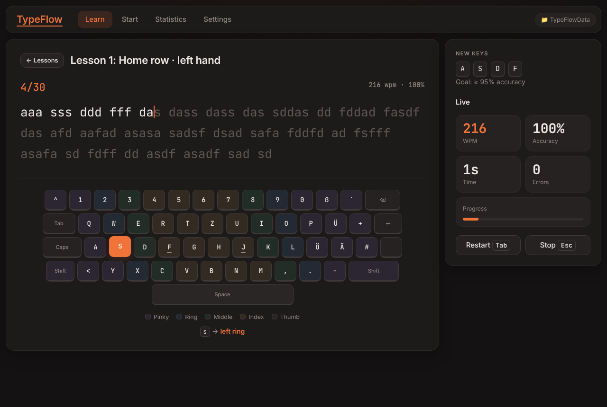
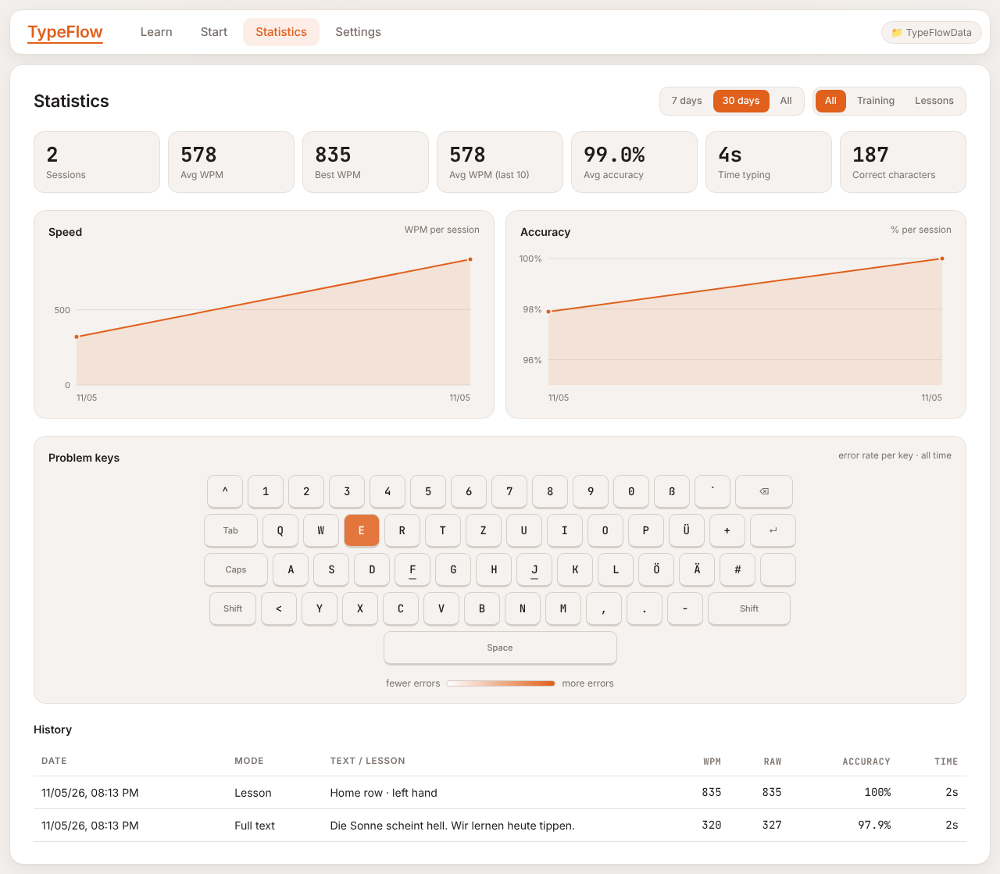

# TypeFlow Wiki

**TypeFlow** ist ein Tipptrainer, der komplett im Browser läuft. Du fügst einen beliebigen Text ein und tippst ihn so schnell wie möglich ab, lernst 10-Finger-Schreiben in Lektionen und verfolgst deinen Fortschritt.

  
  

> [!NOTE]
> Vibe-coded Projekt: größtenteils mit KI-Unterstützung entwickelt, nicht professionell geprüft.

## Schnellstart

1. [`typeflow.html` herunterladen](https://github.com/xypep/TypeFlow/releases/latest/download/typeflow.html)
2. In einen eigenen Ordner legen und per Doppelklick in **Chrome oder Edge** öffnen
3. `Choose folder` klicken und denselben Ordner wählen
4. Im Tab `Start` Text einfügen, dann `Start` drücken und lostippen

## Seiten

| Seite | Inhalt |
|---|---|
| [Installation](Installation) | Download, Start, Browser-Unterstützung |
| [Erste Schritte](Erste-Schritte) | Login, Speicherort, Daten sichern |
| [Training](Training) | `Start`-Tab: Modes, Text-Cleanup, Ergebnis |
| [Lektionen](Lektionen) | `Learn`-Tab: alle 16 Lektionen, Bildschirm-Tastatur |
| [Statistiken](Statistiken) | `Statistics`-Tab: Kennzahlen, Charts, Heatmap |
| [Einstellungen](Einstellungen) | `Settings`-Tab: alle Optionen |
| [Hotkeys](Hotkeys) | Tastenkürzel |
| [Datenbank](Datenbank) | Aufbau von `typeflow-db.json`, Berechnung von WPM/Accuracy |
| [FAQ](FAQ) | Häufige Fragen und Fehlerbehebung |
| [Entwicklung](Entwicklung) | Quellcode, Build, Tests, Releases |
